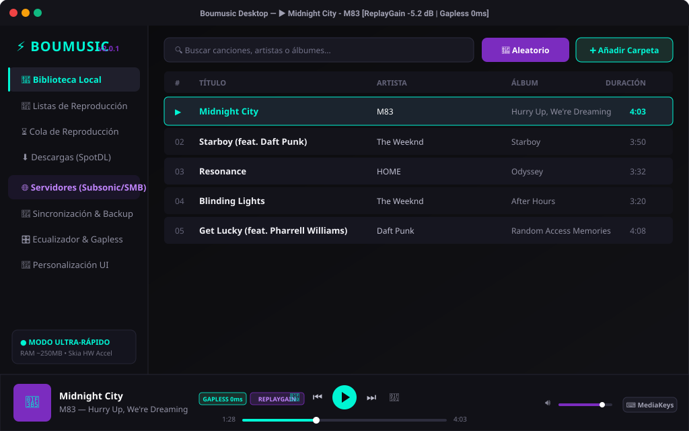
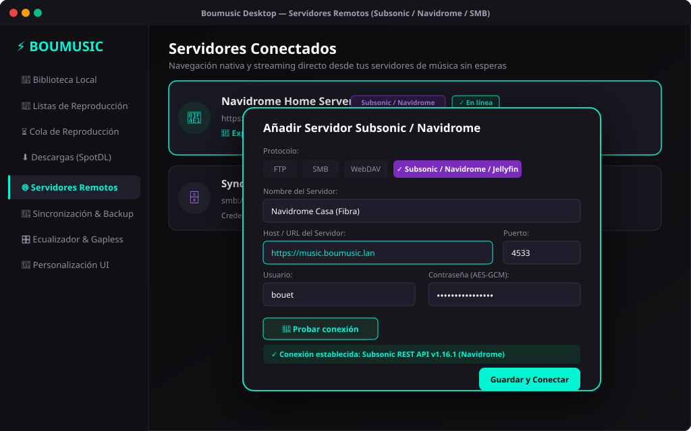
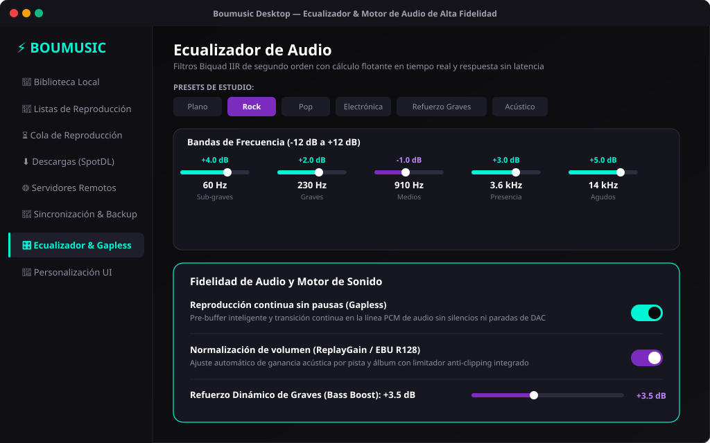
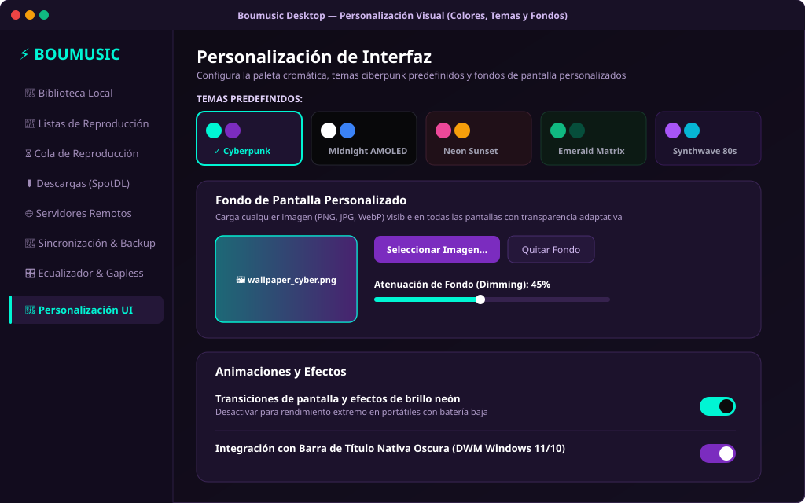

# 🖥️ Boumusic Desktop — Reproductor de Música Moderno y Ligero (Windows & Linux)

[](https://github.com/bouet21/Boumusic-Desktop/releases)
[](#)
[](https://www.jetbrains.com/lp/compose-multiplatform/)
[](#)
[-success)](#)
[](#)

**Boumusic Desktop** es un reproductor de música moderno y de alta fidelidad para ordenador (Windows y Linux) creado desde cero con **Compose Multiplatform (Kotlin)**. Ha sido diseñado para amantes de la música local, audiófilos y self-hosters que buscan una experiencia fluida, estética ciberpunk personalizable, cero publicidad, integración con el sistema operativo y conexión nativa a servidores **Subsonic / Navidrome / Jellyfin**, carpetas **SMB (Windows y Samba)** y servidores en la nube.

---

## 📸 Capturas de Pantalla & Experiencia Visual

<div align="center">

### 🎵 Biblioteca Local y Reproductor con Información en Tiempo Real


<br/>

### 📡 Conexión Nativa a Servidores Subsonic, Navidrome y Carpetas SMB


<br/>

### 🎛️ Ecualizador Biquad IIR de 5 Bandas, Reproducción Gapless y ReplayGain


<br/>

### 🎨 Personalización Visual Extrema: 7 Temas, Colores Libres y Fondos Propios


</div>

---

## ⚡ Flujo de Conexión y Arquitectura

```mermaid
flowchart LR
    subgraph Fuentes ["1. Fuentes de Música"]
        A["📡 Subsonic / Navidrome / Jellyfin"]
        B["🗄️ Red SMB2/SMB3 (Windows/Linux)"]
        C["☁️ WebDAV / Nextcloud / FTPS"]
        D["💾 Almacenamiento Local (FLAC/MP3)"]
    end

    subgraph AudioEngine ["2. Motor de Audio Boumusic"]
        E["🏷️ Extracción ID3v2/Vorbis"]
        F["⚡ Reproducción Gapless (0ms)"]
        G["🎚️ Normalización ReplayGain / EBU"]
        H["🎛️ Ecualizador 5 Bandas (Biquad IIR)"]
    end

    subgraph OSIntegration ["3. Sistema Operativo & Salida"]
        I["⌨️ Teclas Multimedia Globales"]
        J["📌 Bandeja del Sistema (Tray)"]
        K["🪟 Barra Nativa Oscura (DWM)"]
        L["🔊 Salida PCM Directa al DAC"]
    end

    Fuentes --> AudioEngine
    AudioEngine --> OSIntegration
```



---

## ⚡ Rendimiento y Eficiencia

A diferencia de los reproductores modernos construidos sobre Electron o navegadores Chromium embebidos (que suelen devorar entre 500 MB y más de 1 GB de memoria RAM con múltiples procesos auxiliares), Boumusic Desktop se apoya directamente en el motor gráfico nativo **Skia (DirectX en Windows / OpenGL y Vulkan en Linux)**:
- **Consumo moderado de memoria**: Estable en ~250 MB de RAM.
- **0% de uso de CPU en reposo**: Sin procesos ocultos de navegador.
- **Interfaz fluida**: Renderizado acelerado por hardware a 60/120 FPS.

---

## 📲 Descarga Directa (v2.0.1)

| Sistema | Paquete | Enlace de Descarga |
| :--- | :--- | :--- |
| **Windows x64** 🪟 | **Instalador Guiado (Setup EXE)** | 👉 **[Descargar Boumusic-2.0.1-Setup.exe](https://github.com/bouet21/Boumusic-Desktop/releases/download/v2.0.1/Boumusic-2.0.1-Setup.exe)** |
| **Windows x64** 🪟 | **Portable (ZIP)** | 👉 **[Descargar Boumusic-Desktop-v2.0.1-windows-x64.zip](https://github.com/bouet21/Boumusic-Desktop/releases/download/v2.0.1/Boumusic-Desktop-v2.0.1-windows-x64.zip)** |
| **Linux x64** 🐧 | **AppImage Autónomo (Sin requerir Java)** | 👉 **[Descargar Boumusic-2.0.1-x86_64.AppImage](https://github.com/bouet21/Boumusic-Desktop/releases/download/v2.0.1/Boumusic-2.0.1-x86_64.AppImage)** |
| **Linux x64** 🐧 | **Paquete Portable (Tarball + JRE embebido)** | 👉 **[Descargar Boumusic-2.0.1-linux-x64.tar.gz](https://github.com/bouet21/Boumusic-Desktop/releases/download/v2.0.1/Boumusic-2.0.1-linux-x64.tar.gz)** |
| **Linux x64** 🐧 | **Paquete Lanzador (Script + JAR)** | 👉 **[Descargar Boumusic-Linux-x64-v2.0.1.zip](https://github.com/bouet21/Boumusic-Desktop/releases/download/v2.0.1/Boumusic-Linux-x64-v2.0.1.zip)** |

*(Consulta todas las versiones anteriores en la sección de [Releases de GitHub](https://github.com/bouet21/Boumusic-Desktop/releases) o revisa el historial detallado en [CHANGELOG.md](CHANGELOG.md)).*

### 🔒 Verificación de Integridad (SHA-256)

Para verificar que tus archivos descargados son auténticos y no han sufrido alteraciones:

```text
d9fdd87d08597961e12c438b8d1914c90ff27a1b7a18b11404d34d5d90b33f84  Boumusic-2.0.1-Setup.exe
03a6aeb94e59fe4ed1677445dd17710c9c24e709d807c1d61d9b3bfac323f3b8  Boumusic-Desktop-v2.0.1-windows-x64.zip
8efbc0d1bf9387f314eb3d00dc5850bcb7e4263aec003ed5586225854dce9a7d  Boumusic-Linux-x64-v2.0.1.zip
```

---

## ✨ Características Principales

* 📡 **Soporte Oficial Subsonic / Navidrome / Jellyfin**:
  * Conexión REST API v1.16.1 con autenticación segura token + salt MD5.
  * Navegación por artistas, carpetas de música, álbumes recientes y canciones aleatorias.
  * Streaming continuo y descarga con un clic.
* 🗄️ **Soporte Nativo SMB2/SMB3 (Windows y Linux Samba)**:
  * Conéctate directamente a carpetas compartidas de red local a través del puerto 445 sin necesidad de montar unidades de red manuales.
  * Streaming instantáneo sin esperas con extracción de carátulas y metadatos en directo.
* ☁️ **Protocolos de Almacenamiento Remoto (FTP / FTPS / WebDAV)**:
  * Accede a tu música alojada en servidores NAS, Nextcloud, ownCloud o servidores FTP seguros con navegación jerárquica por carpetas.
* ⚡ **Audio de Alta Fidelidad (Gapless & ReplayGain)**:
  * **Gapless Playback Real**: transición instantánea de 0 milisegundos entre pistas consecutivas manteniendo la línea DAC abierta y pre-cargando el audio.
  * **Normalización ReplayGain / EBU R128**: lectura de etiquetas `REPLAYGAIN_TRACK_GAIN` y ajuste dinámico de volumen con limitador anti-clipping.
  * **Ecualizador de 5 Bandas**: filtros Biquad IIR de estudio paramétricos y refuerzo dinámico de graves (*Bass Boost*).
* ⌨️ **Integración Nativa con el Sistema Operativo**:
  * **Teclas Multimedia Globales**: Reproducir, pausar, siguiente y anterior funcionan en segundo plano desde el teclado en Windows y Linux.
  * **Bandeja del Sistema (System Tray)**: Icono persistente en el área de notificación con tooltip dinámico y menú contextual rápido.
  * **Barra de Título Oscura DWM**: Integración con las APIs de Windows 11/10 (`DwmSetWindowAttribute`) para evitar marcos blancos.
* 🎨 **Personalización Visual Completa**:
  * 7 temas predefinidos (*Cyberpunk*, *Midnight AMOLED*, *Neon Sunset*, *Emerald Matrix*, *Synthwave 80s*, *Solar Amber*, *Rose Gold*).
  * Paleta libre de colores primarios y secundarios, fondos base personalizados e imágenes propias de wallpaper con regulador de atenuación (*dimming*).
* 📥 **Módulo de Búsqueda y Descarga**:
  * Búsqueda multi-fuente de alta velocidad (Deezer, iTunes y fuentes abiertas) con carátulas en alta resolución y metadatos limpios.
  * Guardado con un solo clic directamente a tus carpetas de red SMB, servidores FTP o biblioteca local.
* 🔄 **Sincronización Total con Boumusic Android (JSON & M3U8)**:
  * Importa y exporta en un clic copias de seguridad de servidores remotos y listas universales M3U8.
* 🛡️ **Seguridad de Credenciales**:
  * Las contraseñas de servidores remotos se guardan cifradas (AES-GCM de 128 bits), evitando el almacenamiento en texto plano en disco.
* 📦 **Distribución Autónoma para Linux (AppImage & Tarball)**:
  * Empaquetado autónomo con JRE embebido; funciona en cualquier distribución Linux moderna sin configurar Java.

---

## 🚀 Cómo Ejecutar en Desarrollo

Requisitos: **JDK 17 o JDK 21**.

```bash
# Clonar el repositorio
git clone https://github.com/bouet21/Boumusic-Desktop.git
cd Boumusic-Desktop

# Ejecutar la aplicación
./gradlew run

# Ejecutar las pruebas unitarias
./gradlew test
```

---

## 📦 Compilación de Instaladores y Paquetes

Boumusic Desktop utiliza el plugin oficial de Compose Desktop con `jpackage`:

* **Instalador ejecutable de Windows (`Setup.exe`)**:
  ```powershell
  .\gradlew packageExe
  # Genera el instalador en build/compose/binaries/main/exe/Boumusic-2.0.1.exe
  ```
* **Distribución completa autónoma del sistema operativo en curso**:
  ```powershell
  .\gradlew createDistributable
  # Genera la carpeta ejecutable lista en build/compose/binaries/main/app/Boumusic/
  ```
* **Generación de AppImage para Linux (x86_64)**:
  ```bash
  ./scripts/build-linux-appimage.sh
  # Genera Boumusic-2.0.1-x86_64.AppImage
  ```
* **Generación de Tarball portable para Linux**:
  ```bash
  ./scripts/build-linux-tarball.sh
  # Genera Boumusic-2.0.1-linux-x64.tar.gz
  ```

---

## 🗺️ Hoja de Ruta (Roadmap)

- [x] Cliente nativo SMB2/SMB3 para Windows y Linux Samba.
- [x] Soporte oficial para Subsonic / Navidrome / Jellyfin.
- [x] Reproducción Gapless continua sin pausas y normalización ReplayGain.
- [x] Integración con teclas multimedia globales y bandeja del sistema.
- [x] Almacenamiento seguro de credenciales con cifrado AES-GCM.
- [x] Scripts de empaquetado autónomo AppImage y Tarball para Linux.
- [ ] Soporte para macOS (Apple Silicon y x86_64).
- [ ] Control remoto LAN vía WebSocket desde Boumusic Android.

---

## 📄 Licencia

Este proyecto está bajo la Licencia MIT. Consulta el archivo [LICENSE](LICENSE) para más detalles.
